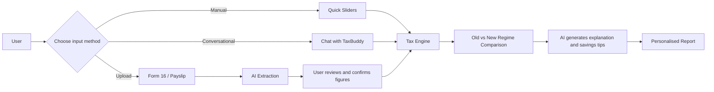
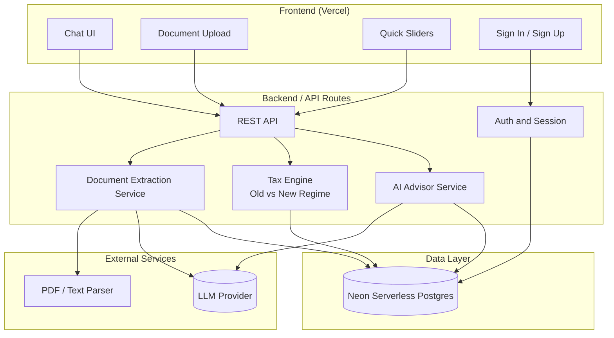
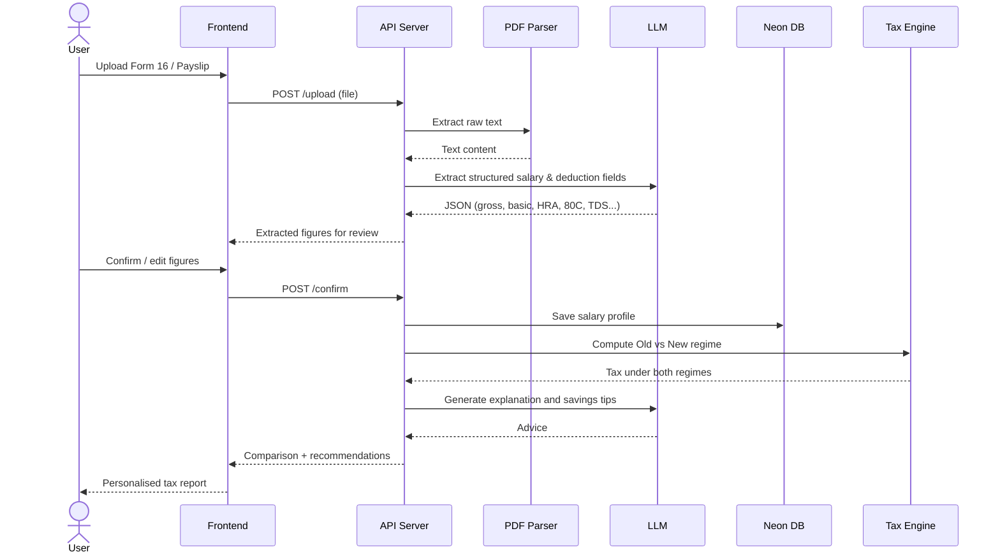
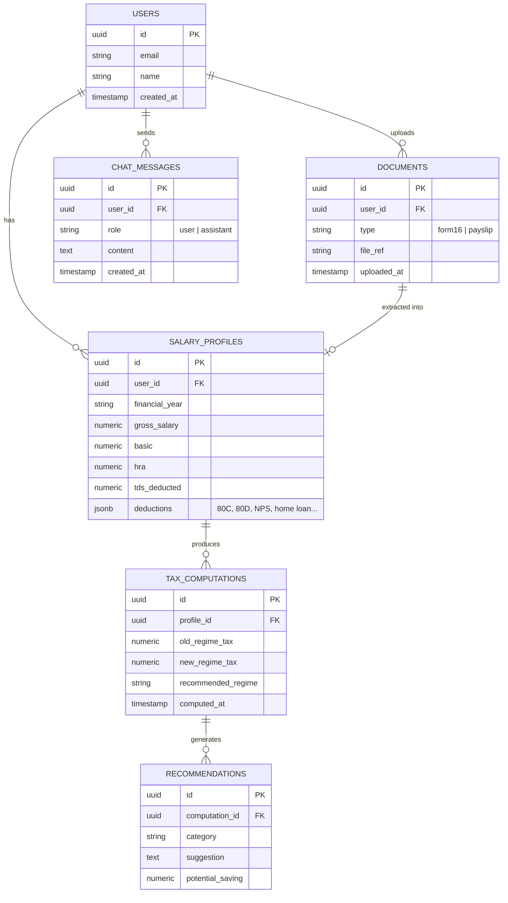

<div align="center">

# ₹ TaxBuddy AI

### Autonomous Tax Optimization & Filing Co-pilot for Salaried Indians

Upload your **Form 16 or payslip**, chat in plain language, and find out instantly whether the **Old or New Tax Regime** saves you more, plus where else you can save.

[**Live Demo**](https://taxbuddy-ai-psi.vercel.app/) · [Report Bug](../../issues) · [Request Feature](../../issues)


</div>

---

## Table of Contents

1. [Why TaxBuddy](#why-taxbuddy)
2. [Features](#features)
3. [How It Works](#how-it-works)
4. [Architecture](#architecture)
5. [Tax Regime Decision Logic](#tax-regime-decision-logic)
6. [Data Model](#data-model)
7. [Project Structure](#project-structure)
8. [Getting Started](#getting-started)
9. [Environment Variables](#environment-variables)
10. [Security & Privacy](#security--privacy)
11. [Roadmap](#roadmap)
12. [Disclaimer](#disclaimer)
13. [Author](#author)

---

## Why TaxBuddy

Every year, salaried employees in India face the same questions:

- *Old regime or new regime, which one actually saves me money?*
- *Am I using 80C, 80D, NPS and HRA properly?*
- *What do all these numbers on my Form 16 mean?*

Most people either guess, or pay for an advisor. **TaxBuddy** gives a personalised, explainable answer in under a minute, using AI to read your documents and a deterministic tax engine to do the maths.

---

## Features

| Feature | Description |
|---|---|
| **AI Chat Advisor** | Ask tax questions in natural language and get answers grounded in your own numbers |
| **Form 16 / Payslip Extraction** | Upload a document and salary and deduction figures are extracted automatically |
| **Old vs New Regime Calculator** | Side-by-side tax comparison with the exact rupee difference |
| **Savings Recommendations** | Personalised suggestions across 80C, 80D, NPS (80CCD(1B)), HRA, home loan interest and more |
| **Quick Sliders** | No documents handy? Enter income and deductions with sliders for a fast estimate |
| **Secure Accounts** | Sign in / Sign up; your data is stored in a managed Postgres database |
| **FY 2025-26 Ready** | Built around the current slabs, rebates and deduction limits |

---

## How It Works



1. **Provide your data**: upload Form 16 or a payslip, use the sliders, or just tell the chatbot your salary.
2. **Confirm the numbers**: extracted values are shown to you before any calculation.
3. **Compute**: a deterministic tax engine calculates tax under both regimes.
4. **Understand**: the AI explains the result in plain language and recommends ways to save.

---

## Architecture



**Design principle:** the LLM is used for *understanding* (extracting fields, explaining, advising). All *tax arithmetic* lives in a deterministic engine so results are reproducible and auditable.

### Document Upload Sequence



---

## Tax Regime Decision Logic

```mermaid
flowchart TD
    S([Start]) --> I[Gross Salary and Other Income]
    I --> N1[Subtract Standard Deduction<br/>New: ₹75,000]
    I --> O1[Subtract Standard Deduction<br/>Old: ₹50,000]

    N1 --> N2[Apply New Regime Slabs]
    N2 --> N3{Taxable income<br/>≤ ₹12 lakh?}
    N3 -->|Yes| N4[Section 87A rebate<br/>Tax = 0]
    N3 -->|No| N5[Slab tax with marginal relief]
    N4 --> N6[Add 4% Cess]
    N5 --> N6

    O1 --> O2[Subtract HRA, 80C, 80D,<br/>80CCD1B, 24b, etc.]
    O2 --> O3[Apply Old Regime Slabs]
    O3 --> O4{Taxable income<br/>≤ ₹5 lakh?}
    O4 -->|Yes| O5[Section 87A rebate<br/>up to ₹12,500]
    O4 -->|No| O6[Slab tax]
    O5 --> O7[Add 4% Cess]
    O6 --> O7

    N6 --> C{Compare}
    O7 --> C
    C -->|New is lower| R1([Recommend New Regime])
    C -->|Old is lower| R2([Recommend Old Regime<br/>and show deductions used])
```



### FY 2025-26 reference values used

> Verify these against the latest Income Tax Department notifications before release.

**New Regime (default)**

| Taxable income | Rate |
|---|---|
| Up to ₹4,00,000 | Nil |
| ₹4,00,001 – ₹8,00,000 | 5% |
| ₹8,00,001 – ₹12,00,000 | 10% |
| ₹12,00,001 – ₹16,00,000 | 15% |
| ₹16,00,001 – ₹20,00,000 | 20% |
| ₹20,00,001 – ₹24,00,000 | 25% |
| Above ₹24,00,000 | 30% |

Standard deduction ₹75,000 · Section 87A rebate up to ₹60,000 (effectively zero tax up to ₹12 lakh taxable income) · 4% health & education cess.

**Old Regime**

| Taxable income | Rate |
|---|---|
| Up to ₹2,50,000 | Nil |
| ₹2,50,001 – ₹5,00,000 | 5% |
| ₹5,00,001 – ₹10,00,000 | 20% |
| Above ₹10,00,000 | 30% |

Standard deduction ₹50,000 · Section 87A rebate up to ₹12,500 · Common deductions: 80C (₹1.5L), 80D, 80CCD(1B) (₹50K), HRA, 24(b) home loan interest (₹2L).

---

## Data Model

> Proposed schema. Adjust to match your actual Neon tables.



---

## Project Structure

> Proposed layout. Rename folders to match your repository.

```
taxbuddy-ai/
├── public/                     # Static assets
├── src/
│   ├── app/                    # Pages and API routes
│   │   ├── api/
│   │   │   ├── chat/           # AI advisor chat endpoint
│   │   │   ├── upload/         # Form 16 / payslip upload
│   │   │   ├── extract/        # Structured field extraction
│   │   │   ├── compute/        # Regime comparison endpoint
│   │   │   └── auth/           # Sign in / Sign up
│   │   ├── dashboard/          # Results and history
│   │   └── page.tsx            # Landing + chat UI
│   ├── components/
│   │   ├── ChatWindow.tsx
│   │   ├── UploadCard.tsx
│   │   ├── QuickSliders.tsx
│   │   ├── RegimeComparison.tsx
│   │   └── SavingsTips.tsx
│   ├── lib/
│   │   ├── tax-engine/
│   │   │   ├── newRegime.ts    # New regime slabs, rebate, cess
│   │   │   ├── oldRegime.ts    # Old regime slabs, deductions
│   │   │   ├── hra.ts          # HRA exemption calculation
│   │   │   └── compare.ts      # Picks the better regime
│   │   ├── ai/
│   │   │   ├── extractor.ts    # Prompt + schema for Form 16 parsing
│   │   │   └── advisor.ts      # Prompt for explanations and tips
│   │   ├── db/                 # Neon client and queries
│   │   └── validators/         # Input and schema validation
│   └── types/
├── tests/
│   └── tax-engine/             # Unit tests with known-answer cases
├── .env.example
├── package.json
└── README.md
```

---

## Getting Started

### Prerequisites

- Node.js 18+
- A [Neon](https://neon.tech) Postgres database
- An API key for your LLM provider

### Installation

```bash
# 1. Clone the repository
git clone https://github.com/anand-tab/taxbuddy-ai.git
cd taxbuddy-ai

# 2. Install dependencies
npm install

# 3. Configure environment
cp .env.example .env.local
# then fill in the values (see below)

# 4. Run database migrations
npm run db:migrate

# 5. Start the dev server
npm run dev
```

Open [http://localhost:3000](http://localhost:3000).

### Run the tax engine tests

```bash
npm test
```

---

## Environment Variables

| Variable | Description |
|---|---|
| `DATABASE_URL` | Neon Postgres connection string |
| `LLM_API_KEY` | API key for the LLM provider used for extraction and advice |
| `AUTH_SECRET` | Secret used to sign sessions |
| `NEXT_PUBLIC_APP_URL` | Public URL of the app |

Never commit `.env.local`.

---

## Security & Privacy

Form 16 documents contain sensitive personal and financial data (PAN, employer details, income). TaxBuddy is built with these principles:

- Extracted data is stored in a managed database over TLS
- Users review extracted data before it is used
- Only the minimum fields needed are sent to the LLM; identifiers such as PAN should be masked or excluded
- Users can delete their data and account
- Secrets live in environment variables, never in source control

---

## Roadmap

- [ ] FY 2026-27 support
- [ ] Capital gains and other income sources
- [ ] Multiple Form 16s (job changes mid-year)
- [ ] Downloadable PDF tax report
- [ ] ITR filing pre-fill export
- [ ] Hindi and regional language support
- [ ] Investment-proof checklist and reminders

---

## Disclaimer

TaxBuddy AI provides **educational guidance and estimates only**. It is not a substitute for advice from a qualified Chartered Accountant or tax professional. Tax laws change; always verify figures with official sources such as the [Income Tax Department](https://www.incometax.gov.in/).

---

## Author

**Sumanshu Anand**
[LinkedIn](https://linkedin.com/in/sumanshu-anand) · [GitHub](https://github.com/anand-tab) · [Portfolio](https://portfolio-2026-rho-jade.vercel.app)

---

<div align="center">

If this project helped you, consider giving it a ⭐

</div>